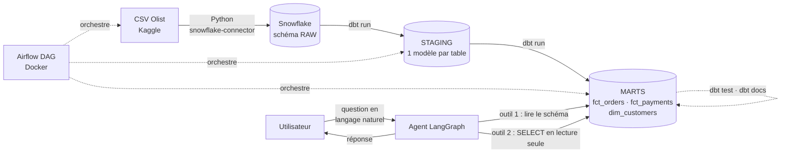
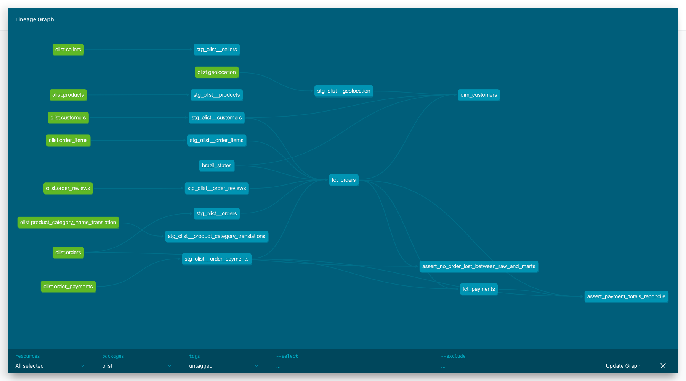

# olist-data-agent

> Assistant de données agentique : des CSV bruts d'un site e-commerce jusqu'à un agent IA qui répond aux questions métier en langage naturel.


**olist-data-agent** est un pipeline de données de bout en bout construit sur le jeu de données
[Olist Brazilian E-Commerce](https://www.kaggle.com/datasets/olistbr/brazilian-ecommerce)
(environ 100 000 commandes réparties sur 9 tables). Les données brutes sont chargées dans Snowflake,
modélisées avec dbt, orchestrées par Airflow, puis interrogées par un agent LangGraph qui traduit
des questions métier en requêtes SQL sécurisées, en lecture seule.

Le projet couvre trois domaines : **commerce** (commandes, produits, vendeurs), **paiements**
(moyens de paiement, paiements en plusieurs fois) et **logistique** (dates de livraison prévues et réelles).

> 🚧 Projet en cours de construction. L'avancement est suivi dans la [feuille de route](#feuille-de-route).

---

## Architecture



| Couche | Rôle |
|---|---|
| **RAW** | Copie fidèle des 9 CSV Olist, sans transformation |
| **STAGING** | Un modèle par table : renommage, typage, nettoyage |
| **MARTS** | Tables métier prêtes à l'analyse, testées et documentées |
| **Agent** | Interface en langage naturel limitée aux marts |

---

## Modèle de données

### Sources (schéma `RAW`)

| Table | Contenu |
|---|---|
| `orders` | Commandes, statut et dates (achat, validation, expédition, livraison prévue et réelle) |
| `order_items` | Articles de chaque commande, prix et frais de port |
| `order_payments` | Paiements : type, nombre d'échéances, montant |
| `order_reviews` | Avis clients : note et commentaire |
| `customers` | Clients et localisation (ville, État) |
| `sellers` | Vendeurs et localisation |
| `products` | Produits, catégorie et dimensions |
| `geolocation` | Correspondance code postal → coordonnées |
| `product_category_name_translation` | Traduction des catégories en anglais |

### Marts

| Modèle | Grain | Exemples de colonnes |
|---|---|---|
| `fct_orders` | 1 ligne par commande | montant total, nombre d'articles, délai de livraison, retard en jours, note moyenne |
| `fct_payments` | 1 ligne par paiement | type de paiement, nombre d'échéances, montant, paiement en plusieurs fois (oui/non) |
| `dim_customers` | 1 ligne par client réel (`customer_unique_id`) | ville, État, région, première et dernière commande, nombre de commandes |

Un seed dbt (`brazil_states`) associe les 27 États brésiliens à leurs 5 grandes régions, absentes du jeu Olist.

### Lignage dbt



### Tests de qualité

`dbt build` : **75 tests au vert, 1 avertissement attendu** (12 modèles, 1 seed, 63 tests).

| Type | Exemples |
|---|---|
| Clés | `unique` et `not_null` sur toutes les clés, clés composites avec `dbt_utils.unique_combination_of_columns` |
| Sources | Unicité de `order_id` et `customer_id` dès le schéma `RAW`, avant toute transformation |
| Intégrité | `relationships` : `fct_orders` → `dim_customers`, `fct_payments` → `fct_orders` |
| Valeurs | `accepted_values` sur `order_status`, `payment_type`, `customer_region`, `review_score` ; `accepted_range` sur les échéances (0 à 24) |
| Règles métier | Montants et délais jamais négatifs, livraison postérieure à l'achat, paiement en plusieurs fois uniquement par carte de crédit |
| Réconciliation | Aucune commande perdue entre `RAW` et `fct_orders` ; total payé identique en staging, dans `fct_payments` et dans `fct_orders` |
| Avertissement | Les 8 commandes « delivered » sans date de livraison sont signalées (`severity: warn`) sans bloquer le pipeline |

### Documentation

- Chaque modèle et chaque colonne est décrit dans des fichiers `.yml`. Le site de documentation se génère avec `dbt docs generate` et s'ouvre avec `dbt docs serve`.
- Les descriptions sont aussi **copiées en commentaires dans Snowflake** (`persist_docs`) : l'agent IA peut les lire directement dans `INFORMATION_SCHEMA`.

### Premiers résultats

- **Le Nordeste a le plus de retards** : 12,7 % des commandes livrées après la date promise, contre 6,1 % dans le Sudeste.
- **49,4 % des paiements se font en plusieurs fois**, soit 63,1 % du montant payé.
- **Un retard fait chuter la note client** : 2,27 / 5 en moyenne, contre 4,29 pour une livraison à l'heure.

👉 Règles de calcul, contrôles de cohérence et requêtes : [docs/data_model.md](docs/data_model.md)

---

## Qualité des données

Les 9 tables brutes ont été profilées avant d'écrire le staging (unicité des clés, conversion des types,
valeurs possibles, cohérence entre tables). Principaux constats :

- **`customer_id` change à chaque commande** : la dimension client repose sur `customer_unique_id` (96 096 personnes pour 99 441 commandes).
- **`review_id` n'est pas unique** : un avis peut couvrir plusieurs commandes. La clé est le couple `(review_id, order_id)`.
- **La géolocalisation compte 1 million de points pour 19 000 codes postaux**, dont 42 hors du Brésil : agrégation par code postal après filtrage.
- **Quelques anomalies isolées** (8 commandes livrées sans date de livraison, 1 commande sans paiement, 2 traductions de catégorie manquantes) traitées explicitement dans les modèles.

👉 Détail des requêtes, des résultats et des décisions : [docs/data_profiling.md](docs/data_profiling.md)

---

## L'agent IA

L'agent est construit avec **LangGraph** et dispose de deux outils :

1. **`get_marts_schema`** : renvoie les tables, colonnes et descriptions des marts (issues de la documentation dbt).
2. **`run_readonly_sql`** : exécute une requête SQL et renvoie le résultat.

### Garde-fous

- Seules les requêtes `SELECT` (et `WITH … SELECT`) sont acceptées. Tout `INSERT`, `UPDATE`, `DELETE`, `DROP`, `CREATE`, `ALTER`, `MERGE`, etc. est rejeté.
- Seul le schéma `MARTS` est accessible : les références à `RAW` ou `STAGING` sont refusées.
- Une instruction par appel, et un `LIMIT` est appliqué par défaut.
- Côté Snowflake, l'agent se connecte avec un rôle dédié qui n'a que le droit `SELECT` sur `MARTS`. La sécurité ne repose donc pas uniquement sur le code.

---

## Exemples de questions

> Les réponses seront ajoutées une fois l'agent opérationnel.

| Question | Réponse de l'agent |
|---|---|
| Quel est le retard moyen de livraison par région ? | *à venir* |
| Quelle part des paiements se fait en plusieurs fois ? | *à venir* |
| Quelles sont les 5 catégories de produits au plus gros chiffre d'affaires ? | *à venir* |
| Les commandes livrées en retard ont-elles une note moyenne plus basse ? | *à venir* |

---

## Choix techniques

| Choix | Pourquoi |
|---|---|
| **Snowflake** | Entrepôt cloud standard, essai gratuit de 30 jours, séparation claire des schémas `RAW` / `STAGING` / `MARTS` et gestion fine des rôles |
| **dbt Core + dbt-snowflake** | Transformations versionnées en SQL, tests et documentation intégrés, lignage des modèles |
| **Ingestion en Python** | Script simple et rejouable avec `snowflake-connector-python` (`PUT` + `COPY INTO` depuis un stage interne) |
| **Airflow dans Docker** | Orchestration reproductible en local : ingestion → `dbt run` → `dbt test` |
| **LangGraph** | Contrôle explicite de la boucle de l'agent (choix de l'outil, exécution, réponse) et ajout facile de garde-fous |
| **Agent limité aux marts** | Les marts sont propres, testés et documentés : l'agent raisonne sur des données fiables, et le périmètre exposé reste réduit |

---

## Structure du dépôt (prévue)

```
olist-data-agent/
├── data/                 # CSV Olist (non versionnés)
├── snowflake/            # setup.sql : warehouse, base, schémas, rôle, utilisateur
├── ingestion/            # Script Python de chargement vers RAW
├── dbt/                  # Projet dbt
│   ├── models/
│   │   ├── staging/
│   │   └── marts/
│   └── tests/
├── airflow/              # docker-compose + DAG
│   └── dags/
├── agent/                # Agent LangGraph et garde-fous
├── docs/                 # Profilage des données brutes, modèle de données des marts
└── README.md
```

---

## Démarrage rapide

> Les instructions détaillées seront complétées au fil du projet.

1. Télécharger le jeu de données sur [Kaggle](https://www.kaggle.com/datasets/olistbr/brazilian-ecommerce) et placer les CSV dans `data/`.
2. Créer un compte d'essai Snowflake et générer une paire de clés :
   ```bash
   mkdir -p ~/.snowflake && cd ~/.snowflake
   openssl genrsa 2048 | openssl pkcs8 -topk8 -inform PEM -out rsa_key.p8 -nocrypt
   openssl rsa -in rsa_key.p8 -pubout -out rsa_key.pub
   ```
   Exécuter ensuite [`snowflake/setup.sql`](snowflake/setup.sql) dans Snowsight avec **Run All**, après y avoir collé la clé publique.
   Enfin, copier `.env.example` en `.env` et renseigner l'identifiant du compte.
3. Installer les dépendances (Python 3.11 ou plus) :
   ```bash
   python3.11 -m venv .venv && source .venv/bin/activate
   pip install -r requirements.txt
   ```
   > Si le projet est dans un dossier synchronisé (OneDrive, iCloud, Dropbox), créer l'environnement virtuel **en dehors** de ce dossier, par exemple dans `~/.venvs/olist-data-agent`. La synchronisation des milliers de fichiers du venv peut bloquer Python.
4. Charger les données : `python ingestion/load_raw.py`
5. Construire et tester les modèles :
   ```bash
   cd dbt
   set -a && source ../.env && set +a
   dbt deps --profiles-dir .
   dbt build --profiles-dir .
   dbt docs generate --profiles-dir . && dbt docs serve --profiles-dir .
   ```
6. Lancer Airflow : `docker compose up` dans `airflow/`
7. Poser une question à l'agent : `python agent/main.py "Quel est le retard moyen de livraison par région ?"`

---

## Feuille de route

- [x] Mise en place : compte Snowflake, dbt Core, dépôt GitHub
- [x] Ingestion des CSV dans le schéma `RAW`
- [x] Modèles dbt de staging
- [x] Marts `fct_orders`, `fct_payments`, `dim_customers`
- [x] Tests de qualité et documentation dbt
- [ ] DAG Airflow (ingestion → dbt run → dbt test)
- [ ] Agent LangGraph avec garde-fous
- [ ] Exemples de questions et réponses dans ce README
