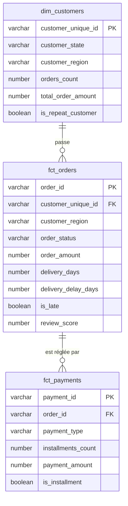
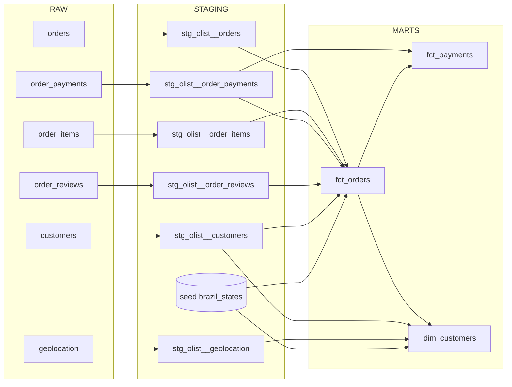

# Modèle de données : les marts

Ce document explique comment sont construits les marts du schéma `MARTS`, comment ils ont été
vérifiés, et ce qu'ils permettent déjà de répondre. Il fait suite à
[l'analyse des données brutes](data_profiling.md), qui décrit ce qu'on a trouvé dans `RAW`.

La description de chaque colonne n'est pas reprise ici : elle se trouve dans
[`dbt/models/marts/_marts.yml`](../dbt/models/marts/_marts.yml) et dans la documentation
générée par `dbt docs`.

[← Retour au README](../README.md)

## Sommaire

- [1. Vue d'ensemble](#1-vue-densemble)
- [2. Lignage](#2-lignage)
- [3. Règles de calcul](#3-règles-de-calcul)
- [4. Contrôles de cohérence](#4-contrôles-de-cohérence)
- [5. Premiers résultats métier](#5-premiers-résultats-métier)
- [6. Points d'attention pour l'agent](#6-points-dattention-pour-lagent)

---

## 1. Vue d'ensemble

| Table | Grain | Lignes | Rôle |
|---|---|---:|---|
| `fct_orders` | 1 ligne par commande | 99 441 | Montants, délais, retard de livraison, note client, localisation |
| `fct_payments` | 1 ligne par paiement | 103 886 | Moyen de paiement, échéances, paiement en plusieurs fois |
| `dim_customers` | 1 ligne par client réel | 96 096 | Localisation et indicateurs cumulés par client |



**Pourquoi ces trois tables ?** Elles couvrent les trois domaines du projet :

- **commerce** : `fct_orders` et `dim_customers` ;
- **paiements** : `fct_payments` ;
- **logistique** : les délais et retards de `fct_orders`.

Pour faciliter le travail de l'agent, les tables de faits sont **légèrement dénormalisées** :
`fct_orders` et `fct_payments` portent directement l'État et la région du client. La plupart des
questions se résolvent ainsi avec une seule table, sans jointure.

---

## 2. Lignage



**Le seed `brazil_states`.** Le jeu Olist ne contient pas de région. On l'ajoute avec un petit
fichier CSV versionné : les 27 unités fédérales du Brésil et leur grande région officielle
(Norte, Nordeste, Centro-Oeste, Sudeste, Sul). C'est ce qui permet de répondre à « retard moyen
par région ».

---

## 3. Règles de calcul

### `fct_orders`

| Colonne | Règle | Pourquoi |
|---|---|---|
| `order_amount` | `items_amount + freight_amount` (articles + frais de port) | Montant de la commande, indépendant du mode de paiement |
| `payments_amount` | Somme des paiements de la commande | Peut dépasser `order_amount` à cause des intérêts des paiements en plusieurs fois |
| `is_delivered` | `order_status = 'delivered'` **et** date de livraison connue | Exclut les 8 commandes « delivered » sans date, qui fausseraient les délais |
| `delivery_days` | Jours calendaires entre l'achat et la livraison | Délai réel vu par le client |
| `delivery_delay_days` | Jours entre la date **promise** et la date de livraison | **Positif = en retard, négatif = en avance** |
| `is_late` | `delivery_delay_days > 0` | Indicateur simple pour calculer un taux de retard |
| `review_score` | Note de l'avis **le plus récent** de la commande | Une commande peut avoir plusieurs avis : en garder un seul évite de dupliquer les commandes |
| `customer_region` | État du client → région, via le seed | Localisation au moment de la commande |

Les colonnes de délai valent `NULL` pour les commandes non livrées, plutôt que 0 ou une valeur
inventée. Les moyennes ne portent ainsi que sur les commandes réellement livrées.

Les jointures vers les articles, les paiements et les avis sont des `left join` : une commande
sans article (775 commandes, presque toutes indisponibles ou annulées), sans paiement (1 commande) ou sans avis
(768 commandes) est conservée.

### `fct_payments`

| Colonne | Règle | Pourquoi |
|---|---|---|
| `payment_id` | `order_id || '-' || payment_sequential` | Clé lisible, unique par paiement |
| `is_installment` | `installments_count > 1` | Les 2 paiements par carte notés « 0 échéance » dans la source comptent comme des paiements en une fois |
| `customer_region`, `order_date`… | Repris de `fct_orders` | Permet d'analyser les paiements par région ou par période sans jointure |

### `dim_customers`

| Colonne | Règle | Pourquoi |
|---|---|---|
| Clé | `customer_unique_id` | `customer_id` change à chaque commande : il ne représente pas une personne |
| Localisation | Adresse de la **commande la plus récente** | Un client peut avoir déménagé entre deux commandes |
| `latitude`, `longitude` | Coordonnées moyennes du code postal (`left join`) | 269 clients ont un code postal absent de la géolocalisation : coordonnées nulles |
| `is_repeat_customer` | `orders_count > 1` | Identifie les clients fidèles |

---

## 4. Contrôles de cohérence

### Tests dbt

`dbt build` : **75 tests au vert, 1 avertissement attendu** (12 modèles, 1 seed, 63 tests).

| Type de test | Exemples |
|---|---|
| Tests sur les sources | Unicité de `order_id` et `customer_id` directement dans `RAW` |
| Règles métier (`dbt_utils.expression_is_true`) | Montants et délais ≥ 0 ; livraison après l'achat ; paiement en plusieurs fois uniquement par carte |
| Plage de valeurs (`dbt_utils.accepted_range`) | `installments_count` entre 0 et 24 |
| Réconciliation (tests SQL dans `dbt/tests/`) | Même nombre de commandes dans `RAW` et `fct_orders` ; même total payé en staging, dans `fct_payments` et dans `fct_orders` |
| Avertissement (`severity: warn`) | Les 8 commandes « delivered » sans date de livraison : signalées sans bloquer le pipeline |
| `unique` + `not_null` | `fct_orders.order_id`, `fct_payments.payment_id`, `dim_customers.customer_unique_id` |
| `relationships` | `fct_orders.customer_unique_id` → `dim_customers` ; `fct_payments.order_id` → `fct_orders` |
| `accepted_values` | `order_status` (8 valeurs), `payment_type` (5), `customer_region` (5), `review_score` (1 à 5) |
| Clés composites (`dbt_utils`) | `(order_id, order_item_number)`, `(review_id, order_id)` en staging |

### Volumétrie

| Contrôle | Attendu | Obtenu |
|---|---:|---:|
| Lignes de `fct_orders` = commandes de `RAW.ORDERS` | 99 441 | 99 441 ✅ |
| Lignes de `fct_payments` = paiements de `RAW.ORDER_PAYMENTS` | 103 886 | 103 886 ✅ |
| Lignes de `dim_customers` = `customer_unique_id` distincts | 96 096 | 96 096 ✅ |
| Clients sans région | 0 | 0 ✅ |

### Écarts connus et expliqués

```sql
select
    count_if(abs(payments_amount - order_amount) > 1)                 as ecart_sup_1_brl,
    count_if(items_count = 0)                                         as sans_article,
    count_if(review_score is null)                                    as sans_avis,
    count_if(order_status = 'delivered' and not is_delivered)         as livrees_sans_date
from marts.fct_orders;
```

| Constat | Nombre | Explication |
|---|---:|---|
| Écart de plus de 1 BRL entre payé et commandé | 1 022 | Intérêts des paiements en plusieurs fois, bons d'achat |
| Commandes sans article | 775 | Pour l'essentiel indisponibles (603) ou annulées (164) |
| Commandes sans avis | 768 | Le client n'a pas répondu au questionnaire |
| Commandes « delivered » sans date de livraison | 8 | Anomalie de la source, exclue des délais |
| Clients sans coordonnées GPS | 269 | Code postal absent de la géolocalisation |

**Chiffre d'affaires (hors commandes annulées) :** 15,74 millions de BRL commandés, 15,87 millions
payés. L'écart d'environ 0,8 % correspond aux intérêts.

---

## 5. Premiers résultats métier

Ces résultats sont calculés directement en SQL sur les marts. Ils serviront de **référence pour
vérifier les réponses de l'agent**.

### Retard de livraison par région

```sql
select
    customer_region,
    count(*)                                   as commandes_livrees,
    round(100 * avg(iff(is_late, 1, 0)), 1)    as pct_en_retard,
    round(avg(delivery_delay_days), 1)         as ecart_moyen_a_la_date_promise_j,
    round(avg(delivery_days), 1)               as delai_moyen_j
from marts.fct_orders
where is_delivered
group by 1
order by pct_en_retard desc;
```

| Région | Commandes livrées | % en retard | Écart moyen à la date promise | Délai moyen |
|---|---:|---:|---:|---:|
| Nordeste | 9 044 | **12,7 %** | -11,3 j | 19,9 j |
| Norte | 1 796 | 8,6 % | -15,6 j | 22,5 j |
| Centro-Oeste | 5 624 | 6,5 % | -12,3 j | 15,0 j |
| Sudeste | 66 193 | 6,1 % | -11,6 j | 10,7 j |
| Sul | 13 813 | 5,9 % | -13,1 j | 14,0 j |

- Le **Nordeste** a le taux de retard le plus élevé, deux fois celui du Sudeste.
- Le **Norte** a le délai le plus long (22,5 jours) mais moins de retards : les dates promises y
  sont plus prudentes.
- Le **Sudeste**, qui concentre 69 % des commandes livrées et 74 % des vendeurs, a le délai
  le plus court : les colis y parcourent moins de distance.

### Part des paiements en plusieurs fois

```sql
select
    count(*)                                                                  as paiements,
    round(100 * avg(iff(is_installment, 1, 0)), 1)                            as pct_paiements,
    round(100 * sum(iff(is_installment, payment_amount, 0)) / sum(payment_amount), 1)
                                                                              as pct_montant
from marts.fct_payments;
```

| Paiements | Part en plusieurs fois (nombre) | Part en plusieurs fois (montant) |
|---:|---:|---:|
| 103 886 | **49,4 %** | **63,1 %** |

Les paiements en plusieurs fois concernent des achats plus chers (197 BRL en moyenne, contre
112 BRL pour un paiement en une fois) : ils représentent la moitié des paiements, mais près des
deux tiers du montant. Seule la carte de crédit le permet.

### Retard et satisfaction client

```sql
select is_late, count(*) as commandes, round(avg(review_score), 2) as note_moyenne
from marts.fct_orders
where is_delivered
group by 1;
```

| Livraison | Commandes | Note moyenne |
|---|---:|---:|
| À l'heure ou en avance | 89 936 | **4,29** / 5 |
| En retard | 6 534 | **2,27** / 5 |

Un retard fait perdre **2 points** de note en moyenne : c'est le facteur de satisfaction le plus
visible du jeu de données.

### Fidélité

**2 997 clients** sur 96 096 (3,1 %) ont passé plus d'une commande. La quasi-totalité des clients
d'Olist n'achète qu'une fois.

---

## 6. Points d'attention pour l'agent

Ces pièges seront repris dans les instructions de l'agent IA, pour qu'il ne donne pas de réponse
juste techniquement mais trompeuse.

| Piège | Bonne pratique |
|---|---|
| **Le retard moyen est négatif** (environ -12 jours), car Olist promet des dates très prudentes | Pour « le retard », répondre avec le **% de commandes en retard** (`is_late`), et préciser l'écart moyen seulement en complément |
| Les délais sont nuls pour les commandes non livrées | Filtrer sur `is_delivered` pour les questions de délai |
| `customer_id` ne représente pas un client | Compter les clients avec `customer_unique_id` ou `dim_customers` |
| `order_amount` et `payments_amount` diffèrent | Utiliser `order_amount` pour le chiffre d'affaires, `payment_amount` pour les questions de paiement |
| Les commandes annulées sont incluses dans `fct_orders` | Les exclure (`order_status <> 'canceled'`) pour le chiffre d'affaires |
| Montants en réaux brésiliens | Toujours préciser « BRL » |

[← Retour au README](../README.md)
